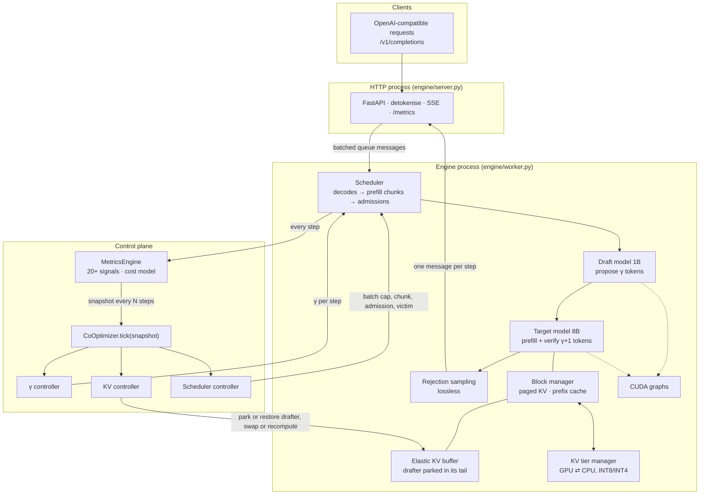

# Unified LLM Inference Co-Optimization

**Coordinated online control of speculative decoding, KV-cache memory and request scheduling through one shared view of the serving system.**

M.Tech thesis project (MTP), School of AI and Data Science, IIT Jodhpur<br>
**Author:** Mohsin Sheikh Mubarak (M25AI2074) · **Supervisor:** Prof. Navchetan Awasthi

> **Status (12 Oct 2026):** the full experiment programme has been **rehearsed on an RTX 4090**
> (single runs, numbers below). The final runs, with 3 repeats each, are next, on an **A100 80 GB**.
> Every number in this README is measured, and is labelled with the hardware it came from.

---

## Contents

1. [TL;DR](#1-tldr)
2. [Why this matters](#2-why-this-matters)
3. [The problem: regime-specific configurations, coupled axes](#3-the-problem-regime-specific-configurations-coupled-axes)
4. [Contributions and positioning](#4-contributions-and-positioning)
5. [System design](#5-system-design)
6. [The co-optimizer](#6-the-co-optimizer)
7. [Correctness and quality](#7-correctness-and-quality)
8. [Experimental methodology](#8-experimental-methodology)
9. [Results (RTX 4090 rehearsal)](#9-results-rtx-4090-rehearsal)
10. [Reproducing everything](#10-reproducing-everything)
11. [Experiment tracking](#11-experiment-tracking)
12. [Repository layout](#12-repository-layout)
13. [Engineering notes](#13-engineering-notes)
14. [Limitations and threats to validity](#14-limitations-and-threats-to-validity)
15. [Roadmap](#15-roadmap)
16. [References](#16-references)

---

## 1. TL;DR

Fast LLM serving depends on three mechanisms:
- **speculative decoding** (a small draft model proposes γ tokens, the large model verifies them in one pass);
- **KV-cache memory** (what stays in GPU memory, what is evicted, what is reused);
- **scheduling** (admission, batch size, preemption).

Production systems configure each one **statically** and **independently**. We measured that every static configuration is badly wrong in some load regime, and that the three axes are coupled through GPU memory. The draft model alone takes about half of the memory the KV cache could otherwise use.

This project builds an inference engine whose speculation, memory and scheduling decisions are all made by **one co-optimizer reading one live snapshot of the system**. When speculation stops paying, the co-optimizer can even park the draft model and hand its memory to the KV cache.

**Headline results (RTX 4090, single runs, GPU-only configurations):**

| | |
|---|---|
| **Coordination matters** | The same three controllers with a shared view vs. independent: **+51 %** goodput at saturation, **+33 %** goodput and **11× lower** tail TTFT at 16 req/s; better or equal in every workload |
| **Beats vLLM's own adaptive speculation** | vs. vLLM's built-in batch-size γ schedule: **4.9×** goodput at saturation, **31× lower** tail TTFT at 16 req/s, +16–33 % on long-context, mixed and phase-shift workloads |
| **Gets speculation's latency without its collapse** | Per-token latency **−40 %** vs. stock vLLM at light load; at chat saturation **+84 %** goodput, where every static speculative configuration collapses |
| **Correct and lossless** | Matches HuggingFace within HF's own kernel-to-kernel noise; speculation is lossless; INT8 KV compression costs **+0.06 %** perplexity |
| **Honest limitation** | Under sudden bursts, stock vLLM's scheduler still admits faster (phase-shift burst SLO 0.75 vs. our 0.32) |

---

## 2. Why this matters

- **Inference is where LLM cost goes.** Every request pays it, so efficiency gains compound across all traffic.
- **The same GPU serves very differently depending on configuration.** Our measurements show large gaps between configurations on identical hardware.
- **Long context collapses throughput.** Stock vLLM on the 4090, 8 concurrent requests:

| Prompt length | Output tok/s | Change | TTFT p99 |
|---|---|---|---|
| 1 K | 331 | — | 0.8 s |
| 4 K | 172 | −48 % | 3.3 s |
| 8 K | 86 | **−74 %** | 9.9 s |

---

## 3. The problem: regime-specific configurations, coupled axes

**Finding 1: every static configuration is wrong somewhere.** Each vLLM configuration we measured falls **≥ 80 % short of the best configuration in at least one regime** (`analysis/regret.py`). Speculation with γ=4 gives the best per-token latency at light load (9.5 ms vs. 17.1 ms), but the worst tail latency on bursty traffic (+225 %).

**Finding 2: the axes are coupled through memory.** On a 24 GB GPU, the 1B draft model plus its KV pool take about half of the KV capacity. Under load, speculation therefore hurts mainly by **queueing**, not by compute:
- choosing γ = 0 does not return that memory;
- a static speculative configuration's burst SLO drops to 0.02–0.17, while the same engine without a drafter reaches 0.54.

A γ decision is therefore also a memory and admission decision.

> **Goal:** a serving system that gets each mechanism's benefit in the regime where it pays, and
> avoids its cost elsewhere, by controlling speculation, memory and admission **jointly**.

---

## 4. Contributions and positioning

| Prior work | What it adapts | What it does not do |
|---|---|---|
| vLLM 0.31 `num_speculative_tokens_per_batch_size` | γ by batch size (static, hand-set table) | The drafter's memory stays resident; no coupling with KV or admission |
| SmartSpec / TurboSpec (Liu et al., 2024) | γ from a goodput model, including γ = 0 | Speculation only |
| **Nightjar** (arXiv 2512.22420, 2025) | Adaptive speculation; **offloads drafter weights under load to grow the KV cache** | No coordinated KV-tier or admission control |
| LMCache, KV offload/quantization, prefix caching | KV capacity | Not speculation-aware |
| AdaServe, Sarathi, Llumnix, … | Scheduling | Not memory- or speculation-aware |

**Our contributions:**
1. **A measurement study** on a modern stack (vLLM 0.31, Llama-3.1-8B). It quantifies that static serving configurations are regime-specific (≥ 80 % worst-case regret) and that speculation's cost under load is mostly *memory*. It includes a phase-shift workload and a regret metric for evaluating adaptivity.
2. **A co-optimizer** in which one shared snapshot drives γ, KV memory and admission, and the speculation controller's learned verdict feeds memory and admission decisions.
3. **A coordination ablation.** The *same* controllers with and without the shared view isolate the value of coordination itself. The system is also evaluated against a Nightjar-like design and against vLLM's built-in adaptive speculation.
4. **An engine to evaluate this fairly:**
   - built from scratch and correct within HuggingFace's own noise;
   - runs **vLLM's own kernels** (FlashAttention, fused RMSNorm, RoPE, SiLU-mul, KV write), so differences come from control, not kernels;
   - adds prefix caching and in-buffer drafter parking with live block migration. The parking mechanism is a variant of Nightjar's drafter offload.

**Not claimed:** any single mechanism as new. Adaptive γ, drafter offload, KV tiering and prefix caching all have prior art. The contribution is **coordinated control, and the evidence that coordination itself pays**.

---

## 5. System design



| File | Role |
|---|---|
| [`engine/model.py`](engine/model.py) | Llama-3 forward written for this project. It uses **vLLM's fused kernels** (FlashAttention with paged KV, fused add+RMSNorm, rotary, SiLU-and-mul, `reshape_and_cache_flash`), the same kernels the vLLM baselines run, and keeps a plain-PyTorch reference path |
| [`engine/block_manager.py`](engine/block_manager.py) | Paged KV with **prefix caching**: chain-hashed full blocks, reference counts, and an LRU pool of evictable cached blocks |
| [`engine/elastic.py`](engine/elastic.py) | **Memory-elastic speculation.** The target KV lives in one block-major buffer, and the drafter's weights and KV sit in its tail. Parking hands the tail blocks to the KV pool (about 3× capacity on the 4090). Unparking migrates live blocks, shared ones included, and restores the weights from pinned host memory |
| [`engine/spec_decode.py`](engine/spec_decode.py) | Batched drafting and **rejection sampling**, which is lossless by construction |
| [`engine/engine.py`](engine/engine.py) | Continuous batching, chunked prefill and preemption. Memory is sized by measurement. The draft step's token and KV budget is bounded, so drafting never takes memory it cannot get |
| [`engine/cuda_graphs.py`](engine/cuda_graphs.py) | CUDA graphs for decode, verify and draft steps, with a shared logits buffer |
| [`engine/worker.py`](engine/worker.py) · [`engine/server.py`](engine/server.py) | The engine and the HTTP server run in **separate processes**, as in vLLM. The server is OpenAI-compatible and exposes Prometheus metrics under vLLM's metric names |
| [`engine/co_optimizer.py`](engine/co_optimizer.py) | The three controllers and the `CoOptimizer` |
| [`engine/kv_tier_manager.py`](engine/kv_tier_manager.py) · [`engine/metrics_engine.py`](engine/metrics_engine.py) | CPU KV tier (INT8/INT4); hardware profiler and `MetricsSnapshot` |

---

## 6. The co-optimizer

Every 8 engine steps, a `MetricsSnapshot` is taken. It covers α, γ in use, KV use on GPU and CPU, queue depth, preemptions, TTFT, step-time model and more, and it is collapsed into one **pressure level** (0–3) that every controller sees.

| Controller | Decides | Rule (coupled mode) |
|---|---|---|
| **γ controller** | One γ ∈ {0, 1, 2, 3, 4, 6, 8} per engine step | A contextual bandit over decode-batch-size bands learns the measured tokens/s of each γ. Pressure caps the allowed γ values. Steps taken while the drafter is parked are not learned from |
| **KV controller** | Park or restore the drafter; swap or recompute on preemption; INT8 or INT4 | Parks on high pressure, **on a growing admission queue (the scheduler's signal)**, or when the **γ controller has learned that drafting does not pay at this batch size**. Restores only when calm and the γ controller agrees. Swaps when PCIe transfer is cheaper than recomputing (measured bandwidths) |
| **Scheduler controller** | Batch cap, prefill chunk, admission order, victim | Additive-increase/multiplicative-decrease batch cap; long prompts deferred at high pressure; aged shortest-first ordering; the victim is the sequence that frees the most KV per unit of sunk work |

**Coordination** is exactly the set of cross-signals: pressure → γ cap, γ verdict → parking, queue → parking, pressure → admission. `ours-independent-controllers` runs the same three controllers, but each sees only its own signals on its own clock (1, 2 and 4 ticks).

### Experiment names

| Name | What it is |
|---|---|
| `ours-cooptimizer` | **The thesis system**: all three controllers, coordinated, with drafter parking |
| `ours-independent-controllers` | Same controllers, no shared view (the coordination ablation) |
| `ours-nightjar-like` | γ controller plus drafter parking only (the closest prior design) |
| `ours-static-spec-gamma4` / `ours-static-no-spec` | Same engine, fixed policy, with or without a draft model |
| `ours-gamma-controller-only`, `ours-kv-controller-only`, `ours-scheduler-controller-only`, `ours-gamma-and-kv`, … | Per-controller and pairwise ablations (`*-no-elastic` = without drafter parking) |
| `vllm-default` / `vllm-default-no-prefix-cache` | Stock vLLM 0.31 |
| `vllm-draft-spec-gamma{1,2,4,6,8}`, `vllm-ngram-spec-gamma4` | vLLM with fixed-γ speculation |
| `vllm-adaptive-spec-schedule` | vLLM's built-in batch-size γ schedule (γ 4 / 2 / 0) |
| `vllm-cpu-kv-offload`, `vllm-kv-budget-*` | CPU KV offload (reported separately, see §9.4); memory-pressure sweep |

Older commits used short codes (A2, B1D_g4, C4_el, W1–W4, …). [`bench/names.py`](bench/names.py) holds the mapping, and every W&B run keeps its old code as `experiment_code`.

---

## 7. Correctness and quality

| Check | Result |
|---|---|
| **Engine vs. HuggingFace** ([`tests/m4_correctness.py`](tests/m4_correctness.py), Llama-3.1-8B, teacher-forced) | **99.58 %** next-token agreement. HF agrees with *itself* across two attention kernels 99.16 % of the time, and every disagreement is a bf16 tie (margin ≤ 0.125 logits) |
| Rejection sampling ([`tests/test_units.py`](tests/test_units.py)) | Lossless: with a deliberately bad draft, the output distribution matches the target within 1 % over 40 k samples |
| CUDA graphs vs. eager, fused vs. reference kernels | Argmax agreement up to bf16 ties |
| Prefix caching + elastic parking ([`tests/elastic_check.py`](tests/elastic_check.py)) | Park and unpark mid-run with 1,283 tail blocks in use; 175 blocks migrated, shared ones included; **0 of 6,144** generated tokens confidently wrong |
| **KV quantization** ([`eval/quality.py`](eval/quality.py), perplexity on 4K-token documents) | bf16 6.7941 · **INT8 6.7982 (+0.06 %)** · INT4 6.8530 (+0.87 %): both under 1 % |
| Unit tests | 16 / 16 (block manager, prefix cache, migration, controllers, drafter parking) |

---

## 8. Experimental methodology

| | |
|---|---|
| Target / draft | `unsloth/Meta-Llama-3.1-8B-Instruct` / `unsloth/Llama-3.2-1B-Instruct` (BF16; ungated mirrors of Meta's weights) |
| Baseline system | vLLM **0.31.0** (PyTorch 2.13, CUDA 13.0); defaults 256 sequences and 2,048 batched tokens on both GPUs |
| Rehearsal | 1× RTX 4090 24 GB, 16 K context, 1 repeat |
| Final | 1× A100 80 GB, 32 K context, **3 repeats** |
| Decoding | temperature 0, `ignore_eos` (identical output lengths for every system) |

| Workload | Content | Arrivals |
|---|---|---|
| `chat` | 200 ShareGPT prompts (median 59 tokens), outputs 32–512 tokens | Poisson at 1, 4, 16 req/s and all at once (`saturation`) |
| `long-context` | 60 LongBench prompts, 8 K–31 K tokens | 16 concurrent |
| `mixed-bursty` | 70 % chat + 30 % LongBench (4–16 K) | 1.5 req/s base, 6 req/s bursts |
| **`phase-shift`** | chat (8 req/s) → long documents (0.5 req/s) → burst (30 req/s) → recovery (2 req/s) | Each phase favours a different static configuration |

**Metrics:**
- output tok/s;
- **goodput**: requests/s meeting the SLO (TTFT ≤ 1 s short / ≤ 10 s long, TPOT ≤ 100 ms);
- TTFT and TPOT p50/p99;
- per-phase SLO attainment;
- failed requests.

**Fairness:** same kernels, same inputs, same batch defaults, the same 1B drafter for every speculative system, and the same GPU for every number in a table.

---

## 9. Results (RTX 4090 rehearsal)

> Single runs, 1× RTX 4090, 16 K context. Engine v3 (prefix caching, fused kernels, separate
> engine process, burst-aware parking). These show the direction and size of effects; the thesis
> numbers will be the A100 runs with 3 repeats.

### 9.1 Main comparison (GPU-only configurations)

| | 1 rps TPOT p99 | 4 rps TPOT p99 | 16 rps goodput (TTFT p99) | Saturation goodput (tok/s) | Long-context tok/s | Mixed-bursty goodput | Phase-shift goodput |
|---|---|---|---|---|---|---|---|
| `vllm-default` | 18.3 ms | 22.7 ms | 8.30 (0.28 s) | 5.18 (3,459) | **69.9** | **0.49** | **2.73** |
| `vllm-draft-spec-gamma4` | 17.2 ms | **17.6 ms** | 5.30 (6.7 s) | 0.65 (2,131) | 49.5 | 0.19 | 1.77 |
| `vllm-adaptive-spec-schedule` | **13.4 ms** | 20.1 ms | 5.95 (6.8 s) | 1.96 (2,084) | 56.3 | 0.24 | 1.78 |
| `ours-static-no-spec` | 19.2 ms | 24.5 ms | 7.90 (0.21 s) | 7.40 (3,239) | 65.5 | 0.28 | 2.39 |
| `ours-static-spec-gamma4` | 13.9 ms | 20.8 ms | 3.80 (13.7 s) | 1.24 (1,576) | 50.6 | 0.18 | 1.47 |
| `ours-nightjar-like` | 14.0 ms | 20.1 ms | **8.18** (0.34 s) | 2.77 (3,076) | 65.4 | 0.28 | 2.16 |
| `ours-independent-controllers` | 16.3 ms | 21.3 ms | 6.13 (2.5 s) | 6.31 (2,510) | 65.9 | 0.32 | 1.94 |
| **`ours-cooptimizer`** | 15.6 ms | 18.1 ms | 8.14 (**0.22 s**) | **9.54** (3,086) | 65.5 | 0.32 | 2.06 |

### 9.2 Phase-shift, phase by phase (SLO attainment · TPOT p50)

| | Chat | Long documents | **Burst** | Recovery | Goodput |
|---|---|---|---|---|---|
| `vllm-default` | 1.00 · 19.2 ms | 1.00 | **0.75** | 0.98 · 17.3 ms | **2.73** |
| `vllm-draft-spec-gamma4` | 1.00 · 10.7 ms | 0.97 | 0.16 | 0.80 · 9.9 ms | 1.77 |
| `vllm-adaptive-spec-schedule` | 1.00 · 10.8 ms | 1.00 | 0.17 | 0.75 · 10.0 ms | 1.78 |
| `ours-static-no-spec` | 1.00 · 21.3 ms | 1.00 | 0.54 | 0.97 · 18.7 ms | 2.39 |
| `ours-static-spec-gamma4` | 1.00 · 11.3 ms | 0.81 | 0.02 | 0.58 · 11.9 ms | 1.47 |
| `ours-nightjar-like` | 1.00 · 11.8 ms | 1.00 | 0.38 | 0.94 · 10.2 ms | 2.16 |
| `ours-independent-controllers` | 1.00 · 11.7 ms | 1.00 | 0.25 | 0.89 · 10.5 ms | 1.94 |
| **`ours-cooptimizer`** | 1.00 · **11.6 ms** | 1.00 | 0.32 | 0.92 · **10.2 ms** | 2.06 |

### 9.3 What this shows

1. **Coordination pays.** `ours-cooptimizer` vs. `ours-independent-controllers` (identical controllers):
   - **+51 %** goodput at saturation;
   - **+33 %** goodput and **11× lower** tail TTFT at 16 req/s;
   - −15 % tail TPOT at 4 req/s;
   - +6 % on phase-shift (burst SLO 0.32 vs. 0.25);
   - equal on mixed-bursty, and worse nowhere.
2. **It beats vLLM's own adaptive speculation:**
   - **4.9×** goodput at saturation;
   - **31× lower** tail TTFT at 16 req/s;
   - +16 % long-context, +33 % mixed-bursty, +16 % phase-shift.
3. **It keeps speculation's light-load benefit without its collapse:**
   - chat and recovery TPOT 11.6 / 10.2 ms vs. 19.2 / 17.3 ms for stock vLLM (**−40 %**);
   - at saturation, **+84 %** goodput over stock vLLM, where every static speculative configuration (ours or vLLM's) collapses to 0.65–1.24.
4. **Against the Nightjar-like design, gains are regime-dependent:** **3.4×** goodput at chat saturation and +14 % on mixed-bursty, but −5 % on phase-shift, where its parking reacts slightly better to the sudden burst.
5. **Where stock vLLM still wins:** sudden bursts. On phase-shift its burst SLO is 0.75 vs. our 0.32, and on mixed-bursty its goodput is 0.49 vs. our 0.32. Our engine without speculation reaches 0.54, so most of the remaining gap is burst admission and prefill scheduling, not control.
6. **The engine itself is competitive.** Without speculation, at chat saturation, our engine beats stock vLLM on goodput (7.40 vs. 5.18) and tail TTFT (1.72 vs. 2.19 s), within 6 % of its throughput.

### 9.4 Reported separately: CPU KV offload (`vllm-cpu-kv-offload`)

vLLM's native CPU KV offload (24 GiB host buffer) adds **host memory** as KV capacity. It is complementary to the control problem studied here, so it is kept out of the GPU-only comparison above. It is reported here for completeness. It is the strongest configuration measured under heavy load:
- saturation goodput 14.69 at 3,826 tok/s;
- phase-shift goodput 2.87, burst SLO 0.84;
- mixed-bursty goodput 0.49.

It does not improve light-load latency (TPOT p99 18.3 ms at 1 req/s). Our engine already has a CPU KV tier. **Co-optimizing host-memory offload as a fourth axis is future work.**

---

## 10. Reproducing everything

```bash
# pod setup (RunPod or any Linux GPU box with a volume at /workspace); ~1 minute
git clone https://github.com/mohsinmubarak/iitj-llm-coopt.git /workspace/IITJ
echo "HF_TOKEN=hf_..."   >  /workspace/.env
echo "WANDB_API_KEY=..." >> /workspace/.env
bash /workspace/IITJ/runpod/setup.sh

# workloads (also committed under data/)
python -m bench.workloads --all

# one experiment, or a resumable queue (finished runs are skipped)
python -m bench.experiment bench/configs/ours-cooptimizer.yaml --profile rtx4090
setsid nohup bash bench/queue.sh a100 vllm-default ours-static-no-spec ours-cooptimizer ours-independent-controllers > /dev/null 2>&1 &

# validation
python -m pytest -q tests/test_units.py
python -m tests.m4_correctness --model unsloth/Meta-Llama-3.1-8B-Instruct
python -m tests.elastic_check
python -m eval.quality q1 && python -m eval.quality q2

# analysis
python -m bench.compare rtx4090/vllm-default rtx4090/ours-cooptimizer --workload chat
python -m analysis.regret --configs vllm-default vllm-draft-spec-gamma4 ours-cooptimizer
bash runpod/sync_from_pod.sh --verify     # mirror pod results to a laptop
```

Run the engine directly:
```bash
python -m engine.server --model unsloth/Meta-Llama-3.1-8B-Instruct --draft unsloth/Llama-3.2-1B-Instruct \
    --policy coopt --controllers gamma,kv,sched --kv-cpu-gb 32 --elastic --port 8000
```

---

## 11. Experiment tracking

Every run is stored as JSON (the source of truth) and mirrored to Weights & Biases:
- projects `iitj-coopt-rtx4090` and `iitj-coopt-a100`;
- runs named like `ours-cooptimizer | phase-shift | scheduled | rep0`, and grouped by experiment.

| W&B run type | Contents |
|---|---|
| `pod` | System metrics for a whole queue; queue and setup logs uploaded live |
| `experiment` | Full server log; controller trace as time series (α, γ, pressure, KV, batch cap, drafter parked) |
| benchmark | Per-request table, percentiles, 1-second time series (GPU, PCIe, KV, queue), raw JSON |
| `validation` | Engine correctness, quality |

Superseded runs (bugs found and fixed during the rehearsal) are kept and tagged `superseded`; on disk they live under `results/<profile>/_superseded/`.

---

## 12. Repository layout

```
├── engine/          # inference engine + control plane (§5)
├── bench/           # workloads, runner, launcher, queue, tracking, names, configs/, profiles/
├── tests/           # unit tests, engine correctness, CUDA-graph / KV-write / elastic checks, profilers
├── eval/            # quality experiments
├── analysis/        # regret analysis
├── data/            # frozen workloads (token ids): chat, long-context, mixed-bursty, phase-shift, prompt-*
├── results/<profile>/<experiment>/<workload>/<load>_rep<k>.json
└── runpod/          # pod setup, sync, queue helpers
```

---

## 13. Engineering notes

Found and fixed during the rehearsal. Several of these matter for interpreting the results.

| Issue | Fix |
|---|---|
| Eager PyTorch decode was CPU-bound: the 1B draft step took 10 ms at any batch size | CUDA graphs: 3.7 ms |
| Batch cap of 128 vs. vLLM's 256; the HTTP server and engine contended for the GIL | Cap of 256 (vLLM's default, checked in its source) and the engine in its own process |
| About 40 unfused kernels per layer | vLLM's fused kernels: decode 7–12 % faster, and more accurate vs. HF |
| No prefix cache: preempted requests recomputed whole prompts | Prefix caching: phase-shift burst SLO 0.39 → 0.54 |
| Draft KV catch-up after a CPU-tier restore was unbounded (out of memory) | One token budget per step for all draft work |
| With prefix caching, the target pool admitted more sequences than the per-sequence draft pool could hold | A sequence whose draft blocks do not fit does not draft that step |
| Drafter parking reacted to memory pressure only, which was too late in bursts | Coupled trigger on the scheduler's queue as well |
| γ controller v1 (analytic cost model, per-sequence γ) lost to a static γ | v2: one γ per step, learned online, γ = 0 allowed |

---

## 14. Limitations and threats to validity

- **Single runs on the 4090.** Variance is not quantified yet; the A100 runs use 3 repeats.
- **Bursts.** Stock vLLM admits sudden bursts better than our engine, and this limits phase-shift and mixed-bursty results.
- **CPU KV offload** (§9.4) outperforms all GPU-only configurations under heavy load. It is complementary, not integrated here.
- **The Nightjar-like comparison** is our re-implementation of the idea in our engine, not the authors' system.
- **Scope:** Llama-3 family, one target/drafter pair, one GPU, greedy decoding.
- **Quality:** speculation is lossless. INT4 KV compression costs +0.87 % perplexity and should be used with care.

---

## 15. Roadmap

- [x] Infrastructure, workloads, harness, W&B tracking, laptop sync, descriptive naming
- [x] Engine v3 (fused kernels, prefix caching, separate process, elastic speculation), validated
- [x] Full rehearsal on the RTX 4090: baselines, ablations, quality, coordination test
- [ ] **A100 80 GB final runs, 3 repeats**
- [ ] Analysis, figures, thesis write-up

---

## 16. References

- W. Kwon et al. *Efficient Memory Management for Large Language Model Serving with PagedAttention.* SOSP 2023.
- Y. Leviathan, M. Kalman, Y. Matias. *Fast Inference from Transformers via Speculative Decoding.* ICML 2023.
- C. Chen et al. *Accelerating Large Language Model Decoding with Speculative Sampling.* 2023.
- X. Liu et al. *Optimizing Speculative Decoding for Serving Large Language Models Using Goodput* (SmartSpec / TurboSpec). arXiv 2406.14066, 2024.
- *Nightjar: Dynamic Adaptive Speculative Decoding for Large Language Models Serving.* arXiv 2512.22420, 2025.
- H. Sun et al. *TriForce.* 2024 · J. Chen et al. *MagicDec.* 2024 · R. Tiwari et al. *QuantSpec.* 2025.
- LMCache (2024–25) · T. Dao. *FlashAttention-2.* 2023 · Y. Bai et al. *LongBench.* ACL 2024.

---

<sub>Python 3.12 · PyTorch 2.13 · vLLM 0.31.0 · transformers 5.17 · FastAPI · Weights & Biases. Experiments run on RunPod.</sub>
