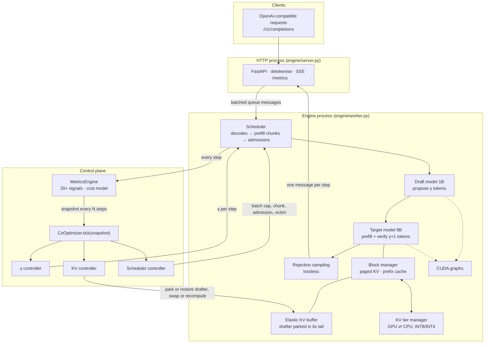

# Unified LLM Inference Co-Optimization

**Coordinated Control of Speculative Decoding, KV-Cache Management, and Admission for Robust LLM Serving**

M.Tech thesis project (MTP), School of AI and Data Science, IIT Jodhpur<br>
**Author:** Mohsin Sheikh Mubarak (M25AI2074) · **Supervisor:** Prof. Navchetan Awasthi

> **Status (23 Oct 2026):** all experiments are complete. The final runs used an **A100 80 GB capped at
> 22 GB** (the RTX 4090's memory budget), with **3 repeats** for every main configuration. The 4090
> rehearsal (single runs) is summarised in §9.7. Every number in this README is measured, and is
> labelled with the hardware it came from.
>
> **Claim, after the A100 runs:** the contribution is **coordination and robustness** of speculative
> serving, not raw speed. On the A100, stock vLLM without speculation still has the highest goodput under
> load. Our engine without speculation trails it by 3–14 %, so most of that gap is the engine.

---

## Contents

1. [TL;DR](#1-tldr)
2. [Why this matters](#2-why-this-matters)
3. [The problem: regime-specific configurations, coupled axes](#3-the-problem-regime-specific-configurations-coupled-axes)
4. [Contributions and positioning](#4-contributions-and-positioning)
5. [System design](#5-system-design)
6. [The co-optimizer](#6-the-co-optimizer)
7. [Correctness and quality](#7-correctness-and-quality)
8. [Experimental methodology](#8-experimental-methodology)
9. [Results (A100, 22 GB)](#9-results-a100-22-gb)
10. [Reproducing everything](#10-reproducing-everything)
11. [Experiment tracking](#11-experiment-tracking)
12. [Repository layout](#12-repository-layout)
13. [Engineering notes](#13-engineering-notes)
14. [Limitations and threats to validity](#14-limitations-and-threats-to-validity)
15. [Roadmap](#15-roadmap)
16. [References](#16-references)

---

## 1. TL;DR

Fast LLM serving depends on three mechanisms:
- **speculative decoding** (a small draft model proposes γ tokens, the large model verifies them in one pass);
- **KV-cache memory** (what stays in GPU memory, what is evicted, what is reused);
- **scheduling** (admission, batch size, preemption).

Production systems configure each one **statically** and **independently**. We measured that every static configuration is badly wrong in some load regime, and that the three axes are coupled through GPU memory. The draft model alone takes about half of the memory the KV cache could otherwise use.

This project builds an inference engine whose speculation, memory and scheduling decisions are all made by **one co-optimizer reading one live snapshot of the system**. When speculation stops paying, the co-optimizer can even park the draft model and hand its memory to the KV cache.

**Headline results (A100 capped at 22 GB, mean of 3 repeats, GPU-only configurations):**

| | |
|---|---|
| **Coordination matters** | The same three controllers with a shared view vs. independent: **+34 %** goodput on the phase-shift workload (3.15 vs. 2.35) and burst-phase SLO **0.42 vs. 0.07**; **+38 %** at chat saturation in the original version; better or equal elsewhere (one confounded case, §9.3) |
| **Speculation's latency without its collapse** | Per-token latency **6.9 ms vs. 12.5 ms** (−45 %) against the same engine without speculation at 1 req/s; under load within ±4 % of it on mixed-bursty, phase-shift and 16 req/s (−15 % at chat saturation) |
| **Beats vLLM's own adaptive speculation** | vs. vLLM's built-in batch-size γ schedule: **4.1×** goodput at saturation (9.72 vs. 2.38), **2×** on mixed-bursty (0.67 vs. 0.33), +32 % on phase-shift |
| **Correct and lossless** | Matches HuggingFace within HF's own kernel-to-kernel noise; speculation is lossless; INT8 KV compression costs **+0.06 %** perplexity |
| **Honest limitation** | Stock vLLM without speculation still leads under load: our system trails it by 2–6 % on 16 req/s, mixed-bursty and phase-shift, and by 27 % at chat saturation. Our engine without any speculation trails it by 3–14 %, so most of the gap is the engine; at saturation, part of it is the control policy |

---

## 2. Why this matters

- **Inference is where LLM cost goes.** Every request pays it, so efficiency gains compound across all traffic.
- **The same GPU serves very differently depending on configuration.** Our measurements show large gaps between configurations on identical hardware.
- **Long context collapses throughput.** Stock vLLM on the 4090, 8 concurrent requests:

| Prompt length | Output tok/s | Change | TTFT p99 |
|---|---|---|---|
| 1 K | 331 | — | 0.8 s |
| 4 K | 172 | −48 % | 3.3 s |
| 8 K | 86 | **−74 %** | 9.9 s |

---

## 3. The problem: regime-specific configurations, coupled axes

**Finding 1: every static configuration is wrong somewhere.** On the A100 (22 GB), stock vLLM reaches 13.37 goodput at chat saturation without speculation, but only **0.04–5.16** with any fixed γ ∈ {1, 2, 4, 6, 8} (single runs). At 1 req/s the order flips: γ = 2 takes **6.8 ms** per token against 10.9 ms without speculation. On the 4090 rehearsal, each vLLM configuration fell **≥ 80 % short of the best configuration in at least one regime** (`analysis/regret.py`).

**Finding 2: the axes are coupled through memory.** On a 24 GB budget, the 1B draft model plus its KV pool take about half of the KV capacity. Under load, speculation therefore hurts mainly by **queueing**, not by compute (4090 rehearsal numbers):
- choosing γ = 0 does not return that memory;
- a static speculative configuration's burst SLO drops to 0.02–0.17, while the same engine without a drafter reaches 0.54.

A γ decision is therefore also a memory and admission decision.

> **Goal:** a serving system that gets each mechanism's benefit in the regime where it pays, and
> avoids its cost elsewhere, by controlling speculation, memory and admission **jointly**.

---

## 4. Contributions and positioning

| Prior work | What it adapts | What it does not do |
|---|---|---|
| vLLM 0.31 `num_speculative_tokens_per_batch_size` | γ by batch size (static, hand-set table) | The drafter's memory stays resident; no coupling with KV or admission |
| SmartSpec / TurboSpec (Liu et al., 2024) | γ from a goodput model, including γ = 0 | Speculation only |
| **Nightjar** (arXiv 2512.22420, 2025) | Adaptive speculation; **offloads drafter weights under load to grow the KV cache** | No coordinated KV-tier or admission control |
| LMCache, KV offload/quantization, prefix caching | KV capacity | Not speculation-aware |
| AdaServe, Sarathi, Llumnix, … | Scheduling | Not memory- or speculation-aware |

**Our contributions:**
1. **A measurement study** on a modern stack (vLLM 0.31, Llama-3.1-8B). It quantifies that static serving configurations are regime-specific (≥ 80 % worst-case regret) and that speculation's cost under load is mostly *memory*. It includes a phase-shift workload and a regret metric for evaluating adaptivity.
2. **A co-optimizer** in which one shared snapshot drives γ, KV memory and admission, and the speculation controller's learned verdict feeds memory and admission decisions.
3. **A coordination ablation.** The *same* controllers with and without the shared view isolate the value of coordination itself. The system is also evaluated against a Nightjar-like design and against vLLM's built-in adaptive speculation.
4. **An engine to evaluate this fairly:**
   - built from scratch and correct within HuggingFace's own noise;
   - runs **vLLM's own kernels** (FlashAttention, fused RMSNorm, RoPE, SiLU-mul, KV write), so differences come from control, not kernels;
   - adds prefix caching and in-buffer drafter parking with live block migration. The parking mechanism is a variant of Nightjar's drafter offload.

**Not claimed:** any single mechanism as new. Adaptive γ, drafter offload, KV tiering and prefix caching all have prior art. The contribution is **coordinated control, and the evidence that coordination itself pays**.

---

## 5. System design



| File | Role |
|---|---|
| [`engine/model.py`](engine/model.py) | Llama-3 forward written for this project. It uses **vLLM's fused kernels** (FlashAttention with paged KV, fused add+RMSNorm, rotary, SiLU-and-mul, `reshape_and_cache_flash`), the same kernels the vLLM baselines run, and keeps a plain-PyTorch reference path |
| [`engine/block_manager.py`](engine/block_manager.py) | Paged KV with **prefix caching**: chain-hashed full blocks, reference counts, and an LRU pool of evictable cached blocks |
| [`engine/elastic.py`](engine/elastic.py) | **Memory-elastic speculation.** The target KV lives in one block-major buffer, and the drafter's weights and KV sit in its tail. Parking hands the tail blocks to the KV pool (about 3× capacity on the 4090). Unparking migrates live blocks, shared ones included, and restores the weights from pinned host memory |
| [`engine/spec_decode.py`](engine/spec_decode.py) | Batched drafting and **rejection sampling**, which is lossless by construction |
| [`engine/engine.py`](engine/engine.py) | Continuous batching, chunked prefill and preemption. Memory is sized by measurement. The draft step's token and KV budget is bounded, so drafting never takes memory it cannot get |
| [`engine/cuda_graphs.py`](engine/cuda_graphs.py) | CUDA graphs for decode, verify and draft steps, with a shared logits buffer |
| [`engine/worker.py`](engine/worker.py) · [`engine/server.py`](engine/server.py) | The engine and the HTTP server run in **separate processes**, as in vLLM. The server is OpenAI-compatible and exposes Prometheus metrics under vLLM's metric names |
| [`engine/co_optimizer.py`](engine/co_optimizer.py) | The three controllers and the `CoOptimizer` |
| [`engine/kv_tier_manager.py`](engine/kv_tier_manager.py) · [`engine/metrics_engine.py`](engine/metrics_engine.py) | CPU KV tier (INT8/INT4); hardware profiler and `MetricsSnapshot` |

---

## 6. The co-optimizer

Every 8 engine steps, a `MetricsSnapshot` is taken. It covers α, γ in use, KV use on GPU and CPU, queue depth, preemptions, TTFT, step-time model and more, and it is collapsed into one **pressure level** (0–3) that every controller sees.

| Controller | Decides | Rule (coupled mode) |
|---|---|---|
| **γ controller** | One γ ∈ {0, 1, 2, 3, 4, 6, 8} per engine step | A contextual bandit over decode-batch-size bands learns the measured tokens/s of each γ. Pressure caps the allowed γ values. Steps taken while the drafter is parked are not learned from |
| **KV controller** | Park or restore the drafter; swap or recompute on preemption; INT8 or INT4 | Parks on high pressure, **on a growing admission queue (the scheduler's signal)**, or when the **γ controller has learned that drafting does not pay at this batch size**. Restores only when calm and the γ controller agrees. Swaps when PCIe transfer is cheaper than recomputing (measured bandwidths) |
| **Scheduler controller** | Batch cap, prefill chunk, admission order, victim | Additive-increase/multiplicative-decrease batch cap; long prompts deferred at high pressure; aged shortest-first ordering; the victim is the sequence that frees the most KV per unit of sunk work. Backoff mode `--sched-backoff`: `pressure` (original) shrinks the cap on preemptions **or** a full GPU; `preempt` (the burst fix, §9.4) shrinks it on preemptions only, grows it while requests wait, and resets it when the queue is empty |

**Coordination** is exactly the set of cross-signals: pressure → γ cap, γ verdict → parking, queue → parking, pressure → admission. `ours-independent-controllers` runs the same three controllers, but each sees only its own signals on its own clock (1, 2 and 4 ticks).

### Experiment names

| Name | What it is |
|---|---|
| `ours-cooptimizer` | All three controllers, coordinated, with drafter parking (original backoff rule) |
| `ours-cooptimizer-preempt-backoff` | **The thesis system**: `ours-cooptimizer` with the burst fix (`--sched-backoff preempt`) |
| `ours-independent-controllers` | Same controllers, no shared view (the coordination ablation) |
| `ours-independent-controllers-preempt-backoff` | The coordination ablation with the burst fix |
| `ours-nightjar-like` | γ controller plus drafter parking only (the closest prior design) |
| `ours-static-spec-gamma4` / `ours-static-no-spec` | Same engine, fixed policy, with or without a draft model |
| `ours-gamma-controller-only`, `ours-kv-controller-only`, `ours-scheduler-controller-only`, `ours-gamma-and-kv`, … | Per-controller and pairwise ablations (`*-no-elastic` = without drafter parking) |
| `vllm-default` / `vllm-default-no-prefix-cache` | Stock vLLM 0.31 |
| `vllm-draft-spec-gamma{1,2,4,6,8}`, `vllm-ngram-spec-gamma4` | vLLM with fixed-γ speculation |
| `vllm-adaptive-spec-schedule` | vLLM's built-in batch-size γ schedule (γ 4 / 2 / 0) |
| `vllm-cpu-kv-offload`, `vllm-kv-budget-*` | CPU KV offload (adds host memory, so not a baseline here, see §14); memory-pressure sweep |

Older commits used short codes (A2, B1D_g4, C4_el, W1–W4, …). [`bench/names.py`](bench/names.py) holds the mapping, and every W&B run keeps its old code as `experiment_code`.

---

## 7. Correctness and quality

| Check | Result |
|---|---|
| **Engine vs. HuggingFace** ([`tests/m4_correctness.py`](tests/m4_correctness.py), Llama-3.1-8B, teacher-forced) | 4090: **99.58 %** next-token agreement; A100: **99.16 %**. HF agrees with *itself* across two attention kernels 99.16 % of the time, and every disagreement is a bf16 tie (median margin 0.125 logits) |
| Rejection sampling ([`tests/test_units.py`](tests/test_units.py)) | Lossless: with a deliberately bad draft, the output distribution matches the target within 1 % over 40 k samples |
| CUDA graphs vs. eager, fused vs. reference kernels | Argmax agreement up to bf16 ties |
| Prefix caching + elastic parking ([`tests/elastic_check.py`](tests/elastic_check.py)) | 4090: park and unpark mid-run with 1,283 tail blocks in use; 175 blocks migrated, shared ones included. A100: 394 blocks migrated. Both: **0 of 6,144** generated tokens confidently wrong |
| **KV quantization** ([`eval/quality.py`](eval/quality.py), perplexity on 4K-token documents) | bf16 6.7941 · **INT8 6.7982 (+0.06 %)** · INT4 6.8530 (+0.87 %): both under 1 % |
| Unit tests | 16 / 16 (block manager, prefix cache, migration, controllers, drafter parking) |

---

## 8. Experimental methodology

| | |
|---|---|
| Target / draft | `unsloth/Meta-Llama-3.1-8B-Instruct` / `unsloth/Llama-3.2-1B-Instruct` (BF16; ungated mirrors of Meta's weights) |
| Baseline system | vLLM **0.31.0** (PyTorch 2.13, CUDA 13.0); defaults 256 sequences and 2,048 batched tokens on both GPUs |
| Rehearsal | 1× RTX 4090 24 GB, 16 K context, 1 repeat |
| **Final** | 1× A100 80 GB **capped at 22 GiB** (profile `a100-22gb`: the 4090's budget, so the 8B weights leave about 5 GiB of KV), 16 K context, **3 repeats** for every main configuration, single runs for ablations and the fixed-γ sweep |
| Also run | A100 at full memory (profile `a100`, single runs, `results/a100/`): calibration and the context-length sweep |
| Decoding | temperature 0, `ignore_eos` (identical output lengths for every system) |

| Workload | Content | Arrivals |
|---|---|---|
| `chat` | 200 ShareGPT prompts (median 59 tokens), outputs 32–512 tokens | Poisson at 1, 4, 16 req/s and all at once (`saturation`) |
| `long-context` | 60 LongBench prompts, 8 K–31 K tokens | 16 concurrent |
| `mixed-bursty` | 70 % chat + 30 % LongBench (4–16 K) | 1.5 req/s base, 6 req/s bursts |
| **`phase-shift`** | chat (8 req/s) → long documents (0.5 req/s) → burst (30 req/s) → recovery (2 req/s) | Each phase favours a different static configuration |

**Metrics:**
- output tok/s;
- **goodput**: requests/s meeting the SLO (TTFT ≤ 1 s short / ≤ 10 s long, TPOT ≤ 100 ms);
- TTFT and TPOT p50/p99;
- per-phase SLO attainment;
- failed requests.

**Fairness:** same kernels, same inputs, same batch defaults, the same 1B drafter for every speculative system, the same GPU and memory budget for every number in a table, and GPU-only systems only (no host-memory KV offload).

---

## 9. Results (A100, 22 GB)

> 1× A100 80 GB capped at 22 GiB, 16 K context. Mean ± std of 3 repeats unless marked. Raw files under
> `results/a100-22gb/`; [`analysis/slide_figures.py`](analysis/slide_figures.py) rebuilds every table
> and figure below from them (figures in [`figures/`](figures/)).

### 9.1 Main comparison (GPU-only configurations)

| | 1 rps TPOT p50 (ms) | 16 rps goodput (TTFT p99) | Saturation goodput | Long-context tok/s | Mixed-bursty goodput | Phase-shift goodput | Burst-phase SLO |
|---|---|---|---|---|---|---|---|
| `vllm-default` | 10.9 ± 0.0 | 10.13 ± 0.36 (0.19 s) | 13.37 ± 0.20 | 116 | 0.72 ± 0.05 | 3.34 ± 0.14 | 0.51 |
| `vllm-adaptive-spec-schedule` | 8.3 ± 1.0 | 7.83 ± 0.26 (4.12 s) | 2.38 ± 0.22 | 82 | 0.33 ± 0.01 | 2.39 ± 0.07 | 0.13 |
| `ours-static-no-spec` | 12.5 ± 0.0 | 9.58 ± 0.29 (0.14 s) | 11.48 ± 1.53 | 111 | 0.66 ± 0.05 | 3.23 ± 0.01 | 0.46 |
| `ours-nightjar-like` | 7.1 ± 0.1 | 9.85 ± 0.44 (0.38 s) | 7.59 ± 3.36 † | 101 | 0.52 ± 0.04 | 3.13 ± 0.00 | 0.41 |
| `ours-independent-controllers` | 7.3 ± 0.1 | 8.46 ± 0.45 (1.90 s) | 7.74 ± 0.23 | 106 | 0.54 ± 0.07 | 2.32 ± 0.01 | 0.07 |
| `ours-cooptimizer` | 7.3 ± 0.3 | 9.63 ± 0.22 (0.43 s) | 10.67 ± 0.41 | 106 | 0.53 ± 0.01 | 2.96 ± 0.09 | 0.34 |
| `ours-independent-controllers-preempt-backoff` | 6.9 ± 0.1 | 9.52 ± 0.37 (1.32 s) | 13.04 ± 2.29 † | 113 | 0.64 ± 0.01 | 2.35 ± 0.01 | 0.07 |
| **`ours-cooptimizer-preempt-backoff`** | **6.9 ± 0.1** | 9.96 ± 0.28 (0.51 s) | 9.72 ± 0.52 | 113 | 0.67 ± 0.02 | 3.15 ± 0.00 | 0.42 |

† Inflated by carry-over between runs (§9.3).

### 9.2 Fixed γ in stock vLLM (single runs except no-spec)

| | no spec | γ=1 | γ=2 | γ=4 | γ=6 | γ=8 |
|---|---|---|---|---|---|---|
| Chat saturation goodput | 13.37 | 3.28 | 5.16 | 2.82 | 2.15 | 0.04 |
| 1 rps TPOT p50 (ms) | 10.9 | 7.7 | 6.8 | 9.6 | 11.0 | 13.6 |

### 9.3 Coordination: the same controllers with and without the shared view

| Goodput | Independent | Co-optimizer | Gain | Independent + fix | Co-optimizer + fix | Gain |
|---|---|---|---|---|---|---|
| Chat 4 rps | 3.81 | 3.80 | 0 % | 3.81 | 3.80 | 0 % |
| Chat 16 rps | 8.46 | 9.63 | **+14 %** | 9.52 | 9.96 | +5 % |
| Chat saturation | 7.74 | 10.67 | **+38 %** | 13.04 † | 9.72 | † |
| Phase-shift | 2.32 | 2.96 | **+28 %** | 2.35 | 3.15 | **+34 %** |
| Mixed-bursty | 0.54 | 0.53 | −1 % | 0.64 | 0.67 | +4 % |
| Burst-phase SLO | 0.07 | 0.34 | | 0.07 | 0.42 | |

**Carry-over between runs.** The chat-saturation run follows the 16 rps run on the same server, and
the drafter's parked state carries over. Runs that start with the drafter already parked score
10.9–14.4:
- two of three `independent + fix` repeats (14.33, 14.39; the clean repeat scores 10.40, against
  9.14–10.13 for the co-optimizer + fix);
- one `ours-nightjar-like` repeat (10.94; the others score 4.22 and 7.61).

All six original co-optimizer and independent saturation runs started unparked, so their +38 % is
clean. The fix is to reset controller and drafter state before each run (roadmap, §15).

### 9.4 The burst fix (`--sched-backoff preempt`)

The original batch-cap rule backed off whenever the GPU was under high pressure. In a burst a full KV
cache is the normal state, so the cap sat near its minimum exactly while requests were waiting. The fix
backs off on preemptions only.

| Co-optimizer | Original | With fix |
|---|---|---|
| Mixed-bursty goodput | 0.53 | **0.67** |
| Phase-shift goodput | 2.96 | **3.15** |
| Burst-phase SLO | 0.34 | **0.42** |
| Chat 16 rps goodput | 9.63 | **9.96** |
| Long-context tok/s | 106 | **113** |
| 1 rps TPOT p50 | 7.3 ms | **6.9 ms** |
| Chat saturation goodput | **10.67** | 9.72 |

### 9.5 Ablations (chat saturation goodput, single runs)

| Without drafter parking | | With drafter parking | |
|---|---|---|---|
| KV only | 2.68 | KV only | 4.31 |
| KV + scheduler | 2.76 | Independent, all three (3 reps) | 7.74 |
| Scheduler only | 2.92 | **Co-optimizer, all three (3 reps)** | **10.67** |
| γ + scheduler | 3.54 | | |
| All three | 3.58 | | |
| γ + KV | 3.71 | | |
| γ only | 4.02 | | |

### 9.6 What this shows

1. **Coordination pays where the load changes.** With identical controllers, the shared view gives
   +34 % on phase-shift (burst SLO 0.42 vs. 0.07), +14 % / +5 % at 16 req/s and +38 % at saturation
   (original version). It is never clearly worse; the one exception is confounded by carry-over.
2. **Parking enables it; coordination makes it pay.** Without parking every variant stays at
   2.7–4.1 goodput at saturation. Parking alone reaches 4.3 and the coordinated system 10.7.
3. **Speculation's latency without its collapse.** Against the same engine without speculation:
   6.9 vs. 12.5 ms per token at 1 req/s, and within ±4 % under load on 16 req/s, mixed-bursty and
   phase-shift. At chat saturation it is 15 % lower (9.72 vs. 11.48).
4. **It beats vLLM's own adaptive speculation** everywhere: 4.1× at saturation, 2× on mixed-bursty,
   +32 % on phase-shift, +27 % at 16 req/s.
5. **Against the Nightjar-like design:** equal on phase-shift (3.15 vs. 3.13), +29 % on mixed-bursty,
   +1 % at 16 req/s; saturation is confounded by carry-over.
6. **Stock vLLM still leads under load.** Our system trails it by 2–6 % on 16 req/s, mixed-bursty and
   phase-shift and by 27 % at saturation. Our engine without speculation trails it by 3–14 %, so most
   of the gap is the engine.

### 9.7 RTX 4090 rehearsal (single runs)

The full programme was rehearsed on an RTX 4090 (24 GB, 16 K context, single runs; `results/rtx4090/`,
W&B project `iitj-coopt-rtx4090`). Coordination paid there as well (+51 % at saturation, +33 % at
16 req/s), and the co-optimizer beat stock vLLM by 84 % at chat saturation. **That last result did not
hold on the A100:** on the 4090 our engine without speculation also beat stock vLLM at saturation
(7.40 vs. 5.18 goodput), while on the A100 it trails (11.48 vs. 13.37). This is why the thesis claim
moved from speed to coordination. The full 4090 tables are in this README's history (commit `3ce4680`).

---

## 10. Reproducing everything

```bash
# pod setup (RunPod or any Linux GPU box with a volume at /workspace); ~1 minute
git clone https://github.com/mohsinmubarak/iitj-llm-coopt.git /workspace/IITJ
echo "HF_TOKEN=hf_..."   >  /workspace/.env
echo "WANDB_API_KEY=..." >> /workspace/.env
bash /workspace/IITJ/runpod/setup.sh

# workloads (also committed under data/)
python -m bench.workloads --all

# one experiment, or a resumable queue (finished runs are skipped)
python -m bench.experiment bench/configs/ours-cooptimizer.yaml --profile rtx4090
setsid nohup bash bench/queue.sh a100 vllm-default ours-static-no-spec ours-cooptimizer ours-independent-controllers > /dev/null 2>&1 &

# validation
python -m pytest -q tests/test_units.py
python -m tests.m4_correctness --model unsloth/Meta-Llama-3.1-8B-Instruct
python -m tests.elastic_check
python -m eval.quality q1 && python -m eval.quality q2

# analysis
python -m bench.compare rtx4090/vllm-default rtx4090/ours-cooptimizer --workload chat
python -m analysis.regret --configs vllm-default vllm-draft-spec-gamma4 ours-cooptimizer
python -m analysis.slide_figures          # A100 tables (stdout) and figures/*.png
bash runpod/sync_from_pod.sh --verify     # mirror pod results to a laptop

# if the pod is gone: fetch result files that are on W&B but not on disk
wandb login
python -m analysis.pull_wandb --project iitj-coopt-a100-22gb --download
```

Run the engine directly (the thesis system, with the burst fix):
```bash
python -m engine.server --model unsloth/Meta-Llama-3.1-8B-Instruct --draft unsloth/Llama-3.2-1B-Instruct \
    --policy coopt --controllers gamma,kv,sched --kv-cpu-gb 32 --elastic --sched-backoff preempt --port 8000
```

---

## 11. Experiment tracking

Every run is stored as JSON (the source of truth) and mirrored to Weights & Biases:
- projects `iitj-coopt-rtx4090`, `iitj-coopt-a100` (full memory, validation) and `iitj-coopt-a100-22gb` (the final results);
- runs named like `ours-cooptimizer | phase-shift | scheduled | rep0`, and grouped by experiment.

| W&B run type | Contents |
|---|---|
| `pod` | System metrics for a whole queue; queue and setup logs uploaded live |
| `experiment` | Full server log; controller trace as time series (α, γ, pressure, KV, batch cap, drafter parked) |
| benchmark | Per-request table, percentiles, 1-second time series (GPU, PCIe, KV, queue), raw JSON |
| `validation` | Engine correctness, quality |

Superseded runs (bugs found and fixed during the rehearsal) are kept and tagged `superseded`; on disk they live under `results/<profile>/_superseded/`.

---

## 12. Repository layout

```
├── engine/          # inference engine + control plane (§5)
├── bench/           # workloads, runner, launcher, queue, tracking, names, configs/, profiles/
├── tests/           # unit tests, engine correctness, CUDA-graph / KV-write / elastic checks, profilers
├── eval/            # quality experiments
├── analysis/        # regret analysis, A100 tables and figures, W&B result pull, meeting deck
├── figures/         # figures built from results/a100-22gb by analysis/slide_figures.py
├── data/            # frozen workloads (token ids): chat, long-context, mixed-bursty, phase-shift, prompt-*
├── results/<profile>/<experiment>/<workload>/<load>_rep<k>.json
└── runpod/          # pod setup, sync, queue helpers
```

---

## 13. Engineering notes

Found and fixed during the rehearsal and the A100 runs. Several of these matter for interpreting the results.

| Issue | Fix |
|---|---|
| Eager PyTorch decode was CPU-bound: the 1B draft step took 10 ms at any batch size | CUDA graphs: 3.7 ms |
| Batch cap of 128 vs. vLLM's 256; the HTTP server and engine contended for the GIL | Cap of 256 (vLLM's default, checked in its source) and the engine in its own process |
| About 40 unfused kernels per layer | vLLM's fused kernels: decode 7–12 % faster, and more accurate vs. HF |
| No prefix cache: preempted requests recomputed whole prompts | Prefix caching: phase-shift burst SLO 0.39 → 0.54 |
| Draft KV catch-up after a CPU-tier restore was unbounded (out of memory) | One token budget per step for all draft work |
| With prefix caching, the target pool admitted more sequences than the per-sequence draft pool could hold | A sequence whose draft blocks do not fit does not draft that step |
| Drafter parking reacted to memory pressure only, which was too late in bursts | Coupled trigger on the scheduler's queue as well |
| γ controller v1 (analytic cost model, per-sequence γ) lost to a static γ | v2: one γ per step, learned online, γ = 0 allowed |
| A100: the batch cap backed off whenever the GPU was full, which in a burst is the normal state, so it sat near its minimum while requests waited | `--sched-backoff preempt`: back off on preemptions only (§9.4) |
| A100: the final queue's results never reached the laptop because the pod stopped before the sync | `analysis/pull_wandb.py` fetches result files from W&B by their repo path |

---

## 14. Limitations and threats to validity

- **Carry-over between runs.** The drafter's parked state carries over between consecutive runs on one server, which inflates some chat-saturation numbers (§9.3). State is not yet reset between runs.
- **Engine gap.** Stock vLLM without speculation leads under load; our engine without speculation trails it by 3–14 %.
- **Ablations, fixed-γ sweep:** single runs. All main configurations have 3 repeats.
- **CPU KV offload** adds host memory as KV capacity, so it is not a baseline for this GPU-only comparison. Co-optimizing it as a fourth axis is future work.
- **The Nightjar-like comparison** is our re-implementation of the idea in our engine, not the authors' system.
- **Scope:** Llama-3 family, one target/drafter pair, one GPU, greedy decoding.
- **Quality:** speculation is lossless. INT4 KV compression costs +0.87 % perplexity and should be used with care.

---

## 15. Roadmap

- [x] Infrastructure, workloads, harness, W&B tracking, laptop sync, descriptive naming
- [x] Engine v3 (fused kernels, prefix caching, separate process, elastic speculation), validated
- [x] Full rehearsal on the RTX 4090: baselines, ablations, quality, coordination test
- [x] A100 final runs (22 GB budget), 3 repeats; burst fix measured
- [ ] Re-run chat saturation with controller and drafter state reset between runs
- [ ] Chapter 3 formal model; thesis write-up

---

## 16. References

- W. Kwon et al. *Efficient Memory Management for Large Language Model Serving with PagedAttention.* SOSP 2023.
- Y. Leviathan, M. Kalman, Y. Matias. *Fast Inference from Transformers via Speculative Decoding.* ICML 2023.
- C. Chen et al. *Accelerating Large Language Model Decoding with Speculative Sampling.* 2023.
- X. Liu et al. *Optimizing Speculative Decoding for Serving Large Language Models Using Goodput* (SmartSpec / TurboSpec). arXiv 2406.14066, 2024.
- *Nightjar: Dynamic Adaptive Speculative Decoding for Large Language Models Serving.* arXiv 2512.22420, 2025.
- H. Sun et al. *TriForce.* 2024 · J. Chen et al. *MagicDec.* 2024 · R. Tiwari et al. *QuantSpec.* 2025.
- LMCache (2024–25) · T. Dao. *FlashAttention-2.* 2023 · Y. Bai et al. *LongBench.* ACL 2024.

---

<sub>Python 3.12 · PyTorch 2.13 · vLLM 0.31.0 · transformers 5.17 · FastAPI · Weights & Biases. Experiments run on RunPod.</sub>
