# Unified LLM Inference Co-Optimization

**Joint online control of speculative decoding, KV-cache tiering and request scheduling through one shared feedback loop.**

M.Tech thesis project (MTP), School of AI and Data Science, IIT Jodhpur<br>
**Author:** Mohsin Sheikh Mubarak (M25AI2074) · **Supervisor:** Prof. Navchetan Awasthi

> **Status (11 Oct 2026):** the engine is built and validated on real hardware. The full
> experiment programme is being **rehearsed on an RTX 4090** (results below, 1 repeat each) before the
> final 3-repeat runs on an **A100 80 GB**. Tier C (our engine) ablations are running now. Every
> number in this README is measured and labelled with the hardware it came from. The rehearsal
> numbers are preliminary and are not the thesis results.

---

## Contents

1. [TL;DR](#1-tldr)
2. [Why this matters](#2-why-this-matters)
3. [Problem: the coherence gap](#3-problem-the-coherence-gap)
4. [Contributions](#4-contributions)
5. [System design](#5-system-design)
6. [The co-optimizer in detail](#6-the-co-optimizer-in-detail)
7. [Correctness and validation](#7-correctness-and-validation)
8. [Experimental methodology](#8-experimental-methodology)
9. [Results so far (RTX 4090 rehearsal)](#9-results-so-far-rtx-4090-rehearsal)
10. [Reproducing everything](#10-reproducing-everything)
11. [Experiment tracking](#11-experiment-tracking)
12. [Repository layout](#12-repository-layout)
13. [Engineering notes](#13-engineering-notes)
14. [Limitations and threats to validity](#14-limitations-and-threats-to-validity)
15. [Roadmap](#15-roadmap)
16. [References](#16-references)

---

## 1. TL;DR

Serving an LLM fast and cheaply depends on three mechanisms:
- **speculative decoding:** a small draft model proposes γ tokens and the large model verifies them in one pass;
- **KV-cache management:** what stays in GPU memory, what is evicted, what is recomputed;
- **request scheduling:** batch size, admission, preemption.

Production systems tune each of these **separately and statically**. This project builds an inference engine
from scratch in which all three are driven by **one controller reading one live snapshot of the system**.
The thesis tests the hypothesis that this coordination beats the same mechanisms tuned independently, and
the strongest stock vLLM configuration on the same GPU.

What exists today:

| | |
|---|---|
| **Engine** | Own Llama-3 implementation with paged KV (vLLM's FlashAttention kernel), continuous batching, chunked prefill, batched speculative decoding with **per-sequence γ**, GPU→CPU KV tiering with **INT8/INT4** compression, and **CUDA graphs** |
| **Control plane** | `MetricsEngine` (20 live signals plus an online step-time model) → `CoOptimizer.tick()` → γ controller + KV controller + scheduler controller. Ablation switches for C0–C6 |
| **Validation** | Engine matches HF transformers on Llama-3.1-8B *within HF's own kernel-to-kernel noise*. Rejection sampling is unit-tested as lossless |
| **Harness** | Frozen, hashed workloads; one benchmark runner for vLLM and for our engine; a resumable experiment queue; full W&B tracking |
| **Evidence so far** | On the 4090: fixed γ helps at moderate load but costs **38–43 % throughput at saturation**, and the best fixed γ depends on load. Better KV handling gives **2.8× goodput** at saturation. Both show the gap this project targets |

---

## 2. Why this matters

- **Inference dominates the cost of LLMs in production.** Every request pays for it, so efficiency gains compound across all traffic.
- **The bottleneck is software, not only hardware.** The same GPU can be several times faster or slower depending on batching, memory management and decoding strategy.
- **Long context is now the norm, and it collapses throughput.** We measured this directly (A3, RTX 4090, stock vLLM, 8 concurrent requests):

| Prompt length | Output tok/s | Change | TTFT p99 |
|---|---|---|---|
| 1 K | 331 | — | 0.8 s |
| 4 K | 172 | −48 % | 3.3 s |
| 8 K | 86 | **−74 %** | 9.9 s |

---

## 3. Problem: the coherence gap

Each axis is optimised in the literature, but **no system controls all three jointly from shared state**.

| Axis | Status quo | What goes wrong |
|---|---|---|
| **γ: draft length** | Fixed per deployment | Over-drafts under memory pressure (every draft token reserves KV and verification compute); under-drafts when the GPU is idle |
| **KV eviction** | Static policy (recompute or LRU) | Ignores queue depth, sequence progress and the PCIe vs. recompute cost; evicts at exactly the wrong moment |
| **Scheduling** | Static batch caps, FCFS | Admits large batches when memory is already tight; unaware of acceptance rate or γ, so it amplifies the crisis it should prevent |

**Goal:** a serving system that is faster than stock vLLM on the same hardware, without degrading output
quality, because γ, KV management and scheduling are controlled **jointly through one shared feedback loop**.

| System | Spec. decoding | KV cache | Scheduling | Joint control |
|---|:-:|:-:|:-:|:-:|
| vLLM + PagedAttention (Kwon et al., SOSP '23) | fixed γ | ✓ | fixed | ✗ |
| TriForce (Sun et al., 2024) | △ | △ | — | ✗ |
| MagicDec (Chen et al., 2024) | △ | △ | — | ✗ |
| QuantSpec (Tiwari et al., 2025) | ✓ | △ | — | ✗ |
| TurboSpec (Liu et al., 2024) | ✓ (adaptive) | — | — | ✗ |
| LMCache (2024–25) | — | ✓ | — | ✗ |
| AdaServe (2025) | △ | — | ✓ | ✗ |
| **This work** | ✓ per-sequence | ✓ tiered + quantized | ✓ adaptive | **✓** |

✓ fully · △ partially · — not addressed

---

## 4. Contributions

1. **A from-scratch inference engine** in which every runtime decision (γ per sequence, batch cap, prefill
   chunk, admission order, preemption victim, swap vs. recompute, KV quantization level) goes through a
   single `Policy` interface. A static policy (C0) and the co-optimizer (C1–C6) therefore run on *identical*
   execution machinery, which makes the ablation clean.
2. **A co-optimizer** with three controllers coupled through one `MetricsSnapshot` and a shared **pressure level**:
   - a cost-model-based **γ controller** (online-fitted step-time model, per-sequence acceptance, pressure caps);
   - a **KV controller** deciding swap vs. recompute per preemption from measured PCIe bandwidth and prefill cost;
   - a **scheduler controller**: AIMD batch cap, adaptive chunking, pressure-aware admission, aged shortest-first ordering.
3. **An ablation that isolates coordination itself (C6):** the *same* three controllers without the shared
   snapshot (own signals, staggered clocks). C4 vs. C6 answers the question "isn't this just three known
   techniques stacked?"
4. **A reproducible evaluation harness:**
   - frozen workloads;
   - one runner for every system;
   - hardware profiles for rehearsal on a cheap GPU and final runs on the A100;
   - per-request, per-second and per-controller-tick logging to JSON and W&B.

---

## 5. System design

```mermaid
flowchart TB
    subgraph Clients
        R[OpenAI-compatible requests<br/>/v1/completions]
    end
    subgraph Engine["Our engine (engine/)"]
        S[server.py<br/>FastAPI · SSE streaming · /metrics]
        SCH[Scheduler<br/>decodes → prefill chunks → admissions]
        DR[Draft model 1B<br/>propose γ tokens]
        TG[Target model 8B<br/>prefill + verify γ+1 tokens]
        RS[Rejection sampling<br/>lossless]
        BM[Block manager<br/>paged KV, GPU]
        KV[KV tier manager<br/>GPU ⇄ CPU, INT8/INT4]
        CG[CUDA graphs<br/>decode-shaped steps]
    end
    subgraph Control["Control plane"]
        ME[MetricsEngine<br/>20+ signals · cost model]
        CO[CoOptimizer.tick&#40;snapshot&#41;]
        GC[γ controller]
        KC[KV controller]
        SC[Scheduler controller]
    end
    R --> S --> SCH
    SCH --> DR --> TG --> RS --> S
    TG --- BM
    DR --- BM
    BM <--> KV
    DR -.-> CG
    TG -.-> CG
    SCH -->|every step| ME
    ME -->|snapshot every N steps| CO
    CO --> GC & KC & SC
    GC -->|γ per sequence| SCH
    KC -->|swap / recompute, bits| KV
    SC -->|batch cap, chunk, admission, victim| SCH
```



### Components

| File | Role |
|---|---|
| [`engine/model.py`](engine/model.py) | Llama-3 forward pass written for this project: HF safetensors weights, fused QKV and gate/up projections, Llama-3 RoPE scaling, fp32 RMSNorm (HF-exact numerics). Attention uses vLLM's bundled `flash_attn_varlen_func` with `block_table`, **the same kernel the vLLM baselines use**, so measured differences come from control decisions, not kernels |
| [`engine/block_manager.py`](engine/block_manager.py) | Paged KV bookkeeping: 16-token blocks, per-sequence block tables, lazy growth, rollback of rejected speculative tokens |
| [`engine/batch.py`](engine/batch.py) | Packs prefill chunks, single-token decodes and (γ+1)-token verifications into one varlen forward pass |
| [`engine/spec_decode.py`](engine/spec_decode.py) | Batched drafting and **rejection sampling** (Leviathan et al. 2023; Chen et al. 2023). The output distribution equals the target model's exactly; at temperature 0 it reduces to "accept while argmax matches" |
| [`engine/engine.py`](engine/engine.py) | Continuous batching, chunked prefill, preemption, the step loop. Measured memory sizing (profiles the activation peak, then sizes the KV pool, like vLLM). A crash in the engine thread takes the server down, so failures are never silent |
| [`engine/cuda_graphs.py`](engine/cuda_graphs.py) | CUDA-graph capture for decode, verify and draft steps. Padded layout with stride S per sequence; padding writes go to a scratch block; one logits buffer is shared across all graphs |
| [`engine/kv_tier_manager.py`](engine/kv_tier_manager.py) | GPU→CPU swap with **per-token-per-head absmax INT8/INT4** quantization; restore on re-admission |
| [`engine/metrics_engine.py`](engine/metrics_engine.py) | Hardware profiler (HBM and PCIe bandwidth measured at start-up) and the `MetricsSnapshot` |
| [`engine/policy.py`](engine/policy.py) | `StaticPolicy`, the knob interface and the C0 baseline |
| [`engine/co_optimizer.py`](engine/co_optimizer.py) | The three controllers and the `CoOptimizer` |
| [`engine/server.py`](engine/server.py) | OpenAI-compatible server. Shared metrics use vLLM's Prometheus names, so the benchmark and dashboards treat both systems identically |

### Life of a request

1. **Admission.** The scheduler admits waiting requests while the batch cap, the token budget and the KV
   watermark allow. The policy decides the order and may defer.
2. **Prefill.** The prompt is processed in chunks of at most `max_batched_tokens` (2,048, vLLM's default),
   mixed into the same forward pass as other sequences' decodes.
3. **Decode with speculation.** For each decoding sequence the policy chooses **γᵢ**. The draft model
   proposes γᵢ tokens (catch-up step plus γᵢ−1 single-token steps, all CUDA-graphed). The target scores all
   γᵢ+1 positions in one pass, and rejection sampling accepts a prefix plus one bonus or correction token.
   Rejected tokens' KV is rolled back.
4. **Memory pressure.** If decodes need more KV blocks than are free, the policy picks a victim. Its KV is
   either **swapped** to CPU (quantized) or **dropped** and recomputed later.
5. **Every N = 8 steps** the `MetricsEngine` produces a snapshot and the policy's `tick()` updates all knobs.

---

## 6. The co-optimizer in detail

### Shared state: one snapshot, one pressure level

Each tick produces a `MetricsSnapshot`:
- **speculation:** α (EMA), γ in use, tokens per step;
- **memory:** p_gpu, p_cpu, evictions per step, KV hit rate;
- **load:** queue depth, pending prefill tokens, mean context length, long-context fraction, preemption rate, TTFT p99, step time, throughput;
- **cost model:** an online-fitted step-time model `t_target ≈ a + b · batch_tokens`, plus the measured draft step time.

These signals are collapsed into one pressure level:

| Pressure | Condition |
|---|---|
| 3 (critical) | p_gpu ≥ 0.97 **or** preemptions > 0.1 / step |
| 2 (high) | p_gpu ≥ 0.90, **or** queue non-empty and p_gpu ≥ 0.85 |
| 1 (medium) | p_gpu ≥ 0.75 |
| 0 (low) | otherwise |

### γ controller: speculation priced on the actual hardware

With acceptance α, a verification of γ drafts yields `E[tokens] = (1 − α^(γ+1)) / (1 − α)`. The controller picks

```
γ* = argmax_γ  E[tokens](α, γ) / ( a + b · n_seq · (γ+1) + γ · t_draft )      (γ ≤ cap, 3 % hysteresis)
```

- **Per-sequence α:** each sequence's own acceptance history is shrunk towards the global EMA (prior weight 8 draft tokens). Easy sequences get a larger γ, hard ones a smaller γ.
- **Coupling:** the pressure level caps γ (`{0: γ_max, 1: 6, 2: 3, 3: 1}`), because every draft token reserves KV and verification compute.
- **The cost model sees load:** large batches make each extra verified token expensive (compute-bound regime), so γ* falls automatically.

### KV controller: swap or recompute?

For a preempted sequence holding n cached tokens:

```
swap      = t_fixed + bytes(n, bits) / BW_d2h + bytes(n, bits) / BW_h2d     (bandwidths measured at start-up)
recompute = b · n · (1 + queue_depth / running)                            (coupled: recompute delays everyone)
```

The controller swaps when it is cheaper. It quantizes evicted KV to INT8, and switches to INT4 when the CPU tier is more than 75 % full.

### Scheduler controller

| Mechanism | Rule |
|---|---|
| Batch cap (AIMD) | ×0.75 on preemption rate > 5 % or pressure 3; +8 when there is a queue and pressure ≤ 1 |
| Prefill chunk | Shrinks to ¼ when decode step time exceeds the TPOT target; never grows beyond the profiled maximum |
| Admission (coupled) | At pressure ≥ 2, prompts over 4,096 tokens are deferred unless they have waited more than 5 s |
| Order | Aged shortest-first, score `(wait + 0.1) / (1 + remaining / 2048)`. Swapped sequences are favoured at low pressure (a restore is cheaper than a prefill) |
| Victim | The sequence freeing the most KV per unit of sunk work: `context_len × (1 − progress)` |

### Ablation configurations

| Config | γ | KV | Scheduler | Shared snapshot |
|---|:-:|:-:|:-:|:-:|
| **C0** static | fixed γ=4 | recompute | FCFS, fixed caps | — |
| **C1** | ✓ | | | ✓ |
| **C2** | | ✓ (32 GiB CPU tier) | | ✓ |
| **C3** | | | ✓ | ✓ |
| **C4** full co-optimizer | ✓ | ✓ | ✓ | ✓ |
| **C5** pairs | 2 of 3 | | | ✓ |
| **C6** independent | ✓ | ✓ | ✓ | **✗** own signals, staggered clocks (1/2/4 ticks) |

**C4 vs. C0** measures the value of control. **C4 vs. C6** measures the value of *coordination*, the thesis
claim. **C4 vs. C1 + C2 + C3** gives the synergy term.

---

## 7. Correctness and validation

A from-scratch engine must prove it computes the same model before any speed claim counts.

**M4: engine vs. HF transformers** ([`tests/m4_correctness.py`](tests/m4_correctness.py), RTX 4090, 16 prompts × 64 tokens, greedy):

| Model | Teacher-forced next-token agreement | **HF vs. HF** (eager vs. SDPA, same weights) | Disagreements | HF top-1/top-2 margin at disagreements | Verdict |
|---|---|---|---|---|---|
| Llama-3.2-1B-Instruct | **99.36 %** | — | 7 / 1,024 | — | ✅ pass |
| Llama-3.1-8B-Instruct | **98.95 %** | **99.16 %** | 10 / 1,024 | **≤ 0.125 logits** | ✅ pass |

HF disagrees with *itself* across two attention kernels about as often as it disagrees with our engine, and
every disagreement is a bf16 near-tie. The prefill top-1 agreement is 100 % for both models.

**Other checks:**

| Check | Result |
|---|---|
| Unit tests ([`tests/test_units.py`](tests/test_units.py)) | 9 / 9 pass: block manager, controllers, and **rejection sampling is lossless** (with a deliberately bad draft, the emitted distribution matches the target within 1 % over 40 k samples) |
| CUDA graphs vs. eager ([`tests/graph_check.py`](tests/graph_check.py)) | 248 / 251 argmax agreement (the rest are bf16 ties, \|Δlogit\| ≤ 0.17); 1B draft step **10.9 → 3.7 ms** |
| KV quantization round trip | INT8: 2× smaller, 0.7 % relative error · INT4: 4× smaller, 12 % error (end-to-end quality impact measured in Q1/S5) |

---

## 8. Experimental methodology

### Setup

| | |
|---|---|
| Target model | `unsloth/Meta-Llama-3.1-8B-Instruct` (BF16; ungated mirror of Meta's weights) |
| Draft model | `unsloth/Llama-3.2-1B-Instruct` (BF16, same tokenizer) |
| Baseline system | vLLM **0.31.0** (PyTorch 2.13, CUDA 13.0) |
| Final hardware | 1× A100 80 GB, 32 K context, **3 repeats**, mean ± std |
| Rehearsal hardware | 1× RTX 4090 24 GB, 16 K context, 1 repeat (doubles as the second-GPU result) |
| Decoding | temperature 0, `ignore_eos` (identical output lengths for every system) |

### Workloads (frozen and hashed; byte-identical token ids for every system)

| | Source | Requests | Prompt tokens | Output | Arrivals |
|---|---|---|---|---|---|
| **W1** chat | ShareGPT | 200 | 36–1,019 (median 59) | reference length, clamped to 32–512 | Poisson at 1, 4, 16, ∞ req/s |
| **W2** long context | LongBench (9 English tasks) | 60 | 8 K–31 K (median 15 K) | 256 | all at once, 16 concurrent |
| **W3** mixed bursty | 70 % W1-style + 30 % LongBench (4–16 K) | 300 | 35–16 K | as above | non-homogeneous Poisson: 1.5 req/s base, 6 req/s bursts (20 s per minute) |
| **A3** fixed length | LongBench text | 32 per length | 1 K, 4 K, 8 K, 16 K, 31.7 K | 128 | 8 concurrent |

### Tiers

| Tier | What | Configs |
|---|---|---|
| **A** floors | Stock vLLM (defaults), context-length scaling, naive HF | A1, A2, A3 |
| **B** strongest vLLM | n-gram spec (B1); same 1B drafter at fixed γ ∈ {1, 2, 4, 6, 8} (B1-D / B1-S); CPU KV offload (B2); KV-budget × concurrency sweep (B2-S); best tuned (B3); B3 + quantized KV cache (B4) | B1 … B4 |
| **C** our engine | Ablation C0–C6 | C0 … C6 |
| Load | Throughput–latency/goodput curve, concurrency sweep, phase-shift workload, OOM stress, long-context scaling | L1–L5 |
| Sensitivity | γ_max, KV threshold, tick interval, α EMA, KV bits | S1–S5 |
| Quality | Perplexity (KV quant off / INT8 / INT4), greedy equivalence, MMLU subset, LongBench scores | Q1–Q4 |
| Mechanism | Controller overhead, live traces, effective tokens/step vs. γ·α | M1–M4 |

The full catalogue, with the significance and priority of every experiment, is in **[EXPERIMENTS.md](EXPERIMENTS.md)**.

### Hypotheses

| | Claim | Evidence |
|---|---|---|
| H1 | No static configuration is optimal across workloads and loads | A3, B1-S, B2-S |
| H2 | Each controller helps in its own regime | C1, C2, C3 vs. C0 |
| H3 | **Joint control through a shared snapshot beats independent controllers** | C4 vs. C5 vs. C6 |
| H4 | No cost in quality, tail latency or stability | Q1–Q4, L4, TTFT p99 |
| H5 | The mechanism works as designed with negligible overhead | M1–M4, S1–S5 |
| H6 | Beats the strongest vLLM configuration on the same GPU | C4 vs. B3/B4 |

### Metrics

- **Primary:** output tokens/s; **goodput** (requests/s meeting the SLO: TTFT ≤ 1 s for short and ≤ 10 s for long prompts, TPOT ≤ 100 ms); TTFT p50/p99; TPOT p50/p99; OOM and failed requests.
- **Secondary:** γ (range, trace); α; KV usage and hit rate; evictions/step; preemption rate; effective tokens/step; controller overhead.

### Fairness controls

- **Same attention kernel:** both systems use vLLM's FlashAttention build.
- **Same inputs:** the same token ids, output lengths, decoding settings and context limit.
- **Same prefill chunk:** 2,048 tokens for both.
- **Same drafter:** the vLLM baseline B1-D uses the same 1B draft model as our engine.
- **Separated effects:** C0 isolates engine differences from control-policy effects.

---

## 9. Results so far (RTX 4090 rehearsal)

> **Hardware:** 1× RTX 4090 24 GB, 16 K context, **single repeat**. W2 keeps the 43 of 60 prompts that fit
> in 16 K; W3 keeps 288 of 300, with arrivals stretched 2× (the unstretched schedule overloaded the 4090
> 2×). These numbers validate the pipeline and the direction of effects. The thesis numbers will come from the A100.

### W1 (chat): throughput and latency by load

| System | 1 req/s tok/s | 4 req/s tok/s | 4 req/s TPOT p99 | 16 req/s tok/s | ∞ tok/s | ∞ goodput (req/s) |
|---|---|---|---|---|---|---|
| A2: stock vLLM | 241 | 856 | 22.7 ms | 2,162 | **3,459** | 5.18 |
| B1: vLLM n-gram, γ=4 | 245 | 872 | 26.5 ms | 1,967 | 2,520 | 3.19 |
| B1-D: vLLM, 1B drafter, γ=1 | 245 | 902 | 17.1 ms | 1,943 | 1,988 | 1.79 |
| B1-D: vLLM, 1B drafter, γ=2 | 246 | 920 | **16.6 ms** | 2,105 | 2,147 | 1.98 |
| B1-D: vLLM, 1B drafter, γ=4 | 247 | **936** | 17.6 ms | 2,091 | 2,131 | 0.65 |
| B2: vLLM + CPU KV offload | 241 | 856 | 21.2 ms | **2,189** | **3,810** | **14.63** |
| **C0: our engine, static γ=4** | 247 | 921 | 25.5 ms | 1,675 | 1,721 | 0.92 |

### W2 (long context) and W3 (mixed bursty)

| System | W2 tok/s | W2 TTFT p99 | W3 tok/s | W3 TTFT p99 | W3 goodput |
|---|---|---|---|---|---|
| A2: stock vLLM | 70 | 55 s | (re-run pending) | | |
| B1: vLLM n-gram, γ=4 | 81 | 48 s | 270 | 29 s | 0.51 |
| B1-D: vLLM, 1B drafter, γ=4 | 50 | 83 s | 214 | 105 s | 0.19 |
| B2: vLLM + CPU KV offload | 71 | 54 s | 265 | 36 s | 0.41 |
| **C0: our engine, static γ=4** | 48 | 89 s | 209 | 109 s | 0.18 |

### What this shows so far

1. **The gap exists (H1).** Speculation with a fixed γ helps at moderate load: +9 % throughput and −22 % TPOT at
   4 req/s. Under saturation it **costs 38–43 % throughput** at every fixed γ, and the best γ differs between
   load levels and metrics. No single static γ is right everywhere, which is the regime the γ controller targets.
2. **Memory handling matters as much as decoding.** CPU KV offload alone gives **2.8× goodput** at saturation
   (TTFT p99 0.8 s vs. 2.2 s), because preempted KV is restored instead of recomputed. This is the mechanism
   our KV controller manages.
3. **Draft-model speculation hurts long context on this GPU** (W2: 70 → 50 tok/s), another regime where
   speculation should back off.
4. **Our engine is a credible platform.** With the same drafter and the same fixed γ, C0 matches vLLM
   (B1-D γ=4) within 2 % on W1 at low and moderate load, and within 2–4 % on W2 and W3. It trails by
   about 20 % at W1 saturation, where vLLM's more mature batching wins. Gains of the co-optimizer are therefore measured against C0
   (same engine) *and* against vLLM.
5. **The controllers react on real hardware** (C4 smoke run): γ settles at 2–3 instead of a fixed 4 (in line
   with the best fixed γ found by the vLLM sweep), the γ cap falls from 8 to 6 when KV usage passes 0.8–0.9,
   the batch cap adapts (124–192), and swapped sequences are restored from CPU.

**Running now:** C1–C6 and the C5 pairs on all workloads; then B1-D γ = 6/8 and the B2-S memory-pressure sweeps.

---

## 10. Reproducing everything

### Prerequisites

- A RunPod (or any Linux) GPU machine with a persistent volume at `/workspace`, Python 3.12, NVIDIA driver supporting CUDA 13.
- A Hugging Face read token, and a W&B API key (optional; logging falls back to offline mode).

### 1. Set up the pod (about 1 minute)

```bash
git clone https://github.com/mohsinmubarak/iitj-llm-coopt.git /workspace/IITJ   # private repo: needs access
echo "HF_TOKEN=hf_..."        >  /workspace/.env
echo "WANDB_API_KEY=..."      >> /workspace/.env
bash /workspace/IITJ/runpod/setup.sh    # uv venv on the container disk; vLLM 0.31.0; downloads both models
```

Use a container disk of at least 40 GB. The Python environment lives on the container disk on purpose:
installing onto the network volume is about 30× slower.

### 2. Build the workloads (once; they are also committed under `data/`)

```bash
python -m bench.workloads --all     # prints the sha256 of each file
```

### 3. Run experiments

```bash
# one config
python -m bench.experiment bench/configs/C4.yaml --profile rtx4090

# a resumable queue (finished runs are skipped on re-launch)
setsid nohup bash bench/queue.sh a100 A2 A3 B1 B1D_g4 B2 C0 C1 C2 C3 C4 C6 > /dev/null 2>&1 &
tail -f results/a100/queue.log

# quick smoke test of any config
python -m bench.experiment bench/configs/C0.yaml --profile rtx4090 --limit 20 --repeats 1 --only W1 --tag smoke
```

A profile ([`bench/profiles/`](bench/profiles/)) sets the context limit, the repeat count, the W&B project and
the W3 arrival scaling for each GPU.

### 4. Validate the engine

```bash
python -m pytest -q tests/test_units.py                                     # CPU
python -m tests.m4_correctness --model unsloth/Meta-Llama-3.1-8B-Instruct   # GPU, about 3 minutes
python -m tests.graph_check                                                 # CUDA graphs vs. eager
```

### 5. Inspect results

```bash
python -m bench.compare rtx4090/A2 rtx4090/B1D_g4 rtx4090/C0 --workload W1
python -m bench.tracking --index            # results/index.jsonl, one row per run (pandas-ready)
bash runpod/sync_from_pod.sh --verify       # mirror pod results to a laptop (incremental)
```

### Run our engine directly

```bash
python -m engine.server --model unsloth/Meta-Llama-3.1-8B-Instruct --draft unsloth/Llama-3.2-1B-Instruct \
    --policy coopt --controllers gamma,kv,sched --kv-cpu-gb 32 --trace trace.jsonl --port 8000
curl localhost:8000/v1/completions -d '{"prompt": "Hello", "max_tokens": 32, "temperature": 0}' -H 'Content-Type: application/json'
```

---

## 11. Experiment tracking

Every run is stored as JSON (the source of truth) and mirrored to Weights & Biases:

| W&B run type | Contents |
|---|---|
| `pod` (one per queue) | GPU, CPU, memory, disk and network system metrics for the whole queue; `queue.log`, setup logs, environment and pip freeze, uploaded live |
| `experiment` (one per config) | Full server log (vLLM or our engine), a benchmark table, and **the controller trace as time series** (α, γ, pressure, KV usage, batch cap, KV bits) |
| per benchmark | Config, summary percentiles, 1-second time series (GPU memory/util/power, PCIe traffic, KV usage, queue depth), per-request table, raw JSON |
| `validation` | M4 results |

Projects: `iitj-coopt-rtx4090` (rehearsal) and `iitj-coopt-a100` (final). The dashboard layout is created
from code ([`bench/dashboard.py`](bench/dashboard.py)).

Each result JSON records:
- per-request TTFT, TPOT, end-to-end latency, token counts and errors;
- a time series sampled every second (NVML GPU memory, utilisation, power, temperature and PCIe; CPU and RAM; server queue, KV and speculation counters);
- server counter deltas;
- the exact server command, the git commit, software versions and the KV capacity.

---

## 12. Repository layout

```
├── engine/                 # the inference engine and control plane (section 5)
├── bench/
│   ├── workloads.py        # seeded W1/W2/W3/A3 builders
│   ├── run.py              # benchmark runner (OpenAI API, per-request + time-series metrics)
│   ├── experiment.py       # start server → run workloads × rates × repeats → stop
│   ├── queue.sh            # resumable experiment queue (+ pod logger)
│   ├── tracking.py         # index.jsonl + W&B (pod / experiment / benchmark runs)
│   ├── podlog.py           # pod-level W&B run: system metrics + live log upload
│   ├── dashboard.py        # W&B workspace layout
│   ├── compare.py          # side-by-side summaries
│   ├── configs/            # A2, A3, B1, B1D_g*, B2, B2S_*, C0–C6
│   └── profiles/           # rtx4090.yaml, a100.yaml
├── tests/                  # unit tests, M4 correctness, CUDA-graph check, step profiler
├── data/                   # frozen workloads (token ids)
├── results/<profile>/<experiment>/<workload>/<rate>_rep<k>.json  (+ server.log, trace.jsonl, queue.log)
├── runpod/                 # setup.sh, sync_from_pod.sh
└── EXPERIMENTS.md          # full experiment catalogue with significance
```

---

## 13. Engineering notes

These were found and fixed while building the system. They are recorded because several of them matter for
interpreting the results.

| Issue | Effect | Fix |
|---|---|---|
| Eager PyTorch decode is CPU-bound | The 1B draft step took 10 ms at any batch size (the GPU floor is about 2.7 ms), so speculation gained nothing | CUDA graphs for decode-shaped steps: 3.7 ms |
| A graph input tensor was freed after capture | Replay read freed memory (device-side assert) | Every graph input lives as long as the graph |
| Separate logits buffers per graph | About 2 GB for 56 graphs, causing OOM | One shared logits buffer |
| The activation headroom was a guess | OOM on long-prompt prefill | Profile the peak activation, then size the KV pool |
| A crash in the engine thread was silent | The HTTP server stayed up and every request hung | The engine-thread crash exits the process, so the benchmark records the failure |
| Swap cost model omitted the fixed swap overhead | Swapped even 16-token sequences | Fixed overhead plus marginal recompute cost (caught by a unit test) |
| vLLM 0.31 with γ ≥ 6 | CUDA-graph range assert at start-up | `--max-cudagraph-capture-size 2048` (equal to what γ ≤ 4 gets implicitly) |
| KV budgets below one max-length sequence | vLLM refuses to start | Budgets scale with the context limit |
| Unstretched W3 on the 4090 | 2× overload: every system saturated, differences hidden | Per-profile arrival scaling |

---

## 14. Limitations and threats to validity

- **Rehearsal numbers are single-repeat.** Variance is not yet quantified; the A100 runs use 3 repeats.
- **Engine maturity.** C0 trails vLLM by about 20 % at saturation (vLLM's batching and kernels are more
  optimised). Co-optimizer gains are therefore reported against C0 (same engine) as well as against vLLM.
- **Quality.** Speculative decoding is lossless by construction. The only lossy component is KV quantization
  on swap, measured explicitly in Q1/S5. INT4 has a high reconstruction error (12 %) and may not be acceptable.
- **Scope.** One model family (Llama-3) and one drafter, on a single GPU. The GPU and CPU tiers are
  implemented; NVMe is out of scope. Greedy decoding only in the benchmarks.
- **Cost model.** The γ controller assumes i.i.d. acceptance per token, which is a standard simplification.

---

## 15. Roadmap

- [x] Infrastructure, workloads, benchmark harness, W&B tracking, pod ⇄ laptop sync
- [x] Tier A/B baselines on the RTX 4090 (A2, A3, B1, B1-D γ = 1/2/4, B2)
- [x] Engine and co-optimizer; M4 correctness; CUDA graphs; C0/C4 smoke tests
- [ ] **C1–C6 ablation on the RTX 4090** (running)
- [ ] B1-D γ = 6/8, B2-S sweeps, B3/B4 (best tuned vLLM)
- [ ] Load tests L1–L5, sensitivity S1–S5, quality Q1–Q4, overhead M1/M2
- [ ] Full programme on the A100 80 GB, 3 repeats
- [ ] Analysis, figures, thesis write-up

---

## 16. References

- W. Kwon et al. *Efficient Memory Management for Large Language Model Serving with PagedAttention.* SOSP 2023.
- Y. Leviathan, M. Kalman, Y. Matias. *Fast Inference from Transformers via Speculative Decoding.* ICML 2023.
- C. Chen et al. *Accelerating Large Language Model Decoding with Speculative Sampling.* 2023.
- H. Sun et al. *TriForce: Lossless Acceleration of Long Sequence Generation with Hierarchical Speculative Decoding.* 2024.
- J. Chen et al. *MagicDec: Breaking the Latency-Throughput Tradeoff for Long Context Generation with Speculative Decoding.* 2024.
- R. Tiwari et al. *QuantSpec: Self-Speculative Decoding with Hierarchical Quantized KV Cache.* 2025.
- X. Liu et al. *Optimizing Speculative Decoding for Serving Large Language Models Using Goodput* (TurboSpec). 2024.
- LMCache: KV-cache layer for LLM serving engines. 2024–2025.
- T. Dao. *FlashAttention-2: Faster Attention with Better Parallelism and Work Partitioning.* 2023.
- Y. Bai et al. *LongBench: A Bilingual, Multitask Benchmark for Long Context Understanding.* ACL 2024.

---

<sub>Built with Python 3.12 · PyTorch 2.13 · vLLM 0.31.0 · transformers 5.17 · FastAPI · Weights & Biases. Experiments run on RunPod.</sub>
